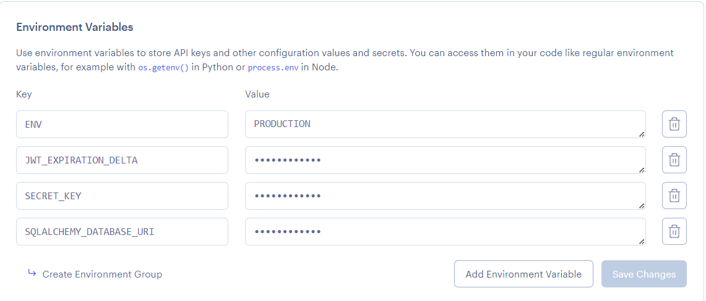

# Game App
A simple gamThen execute the command by invoking the flask CLI with the command name and relevant paraThen execute the command by invoking the flask CLI with the command name and relevant parameters.

# API Endpoints

## Authentication Endpoints

### Identify Current User

The identify endpoints return information about the currently authenticated user, including their user type.

#### Web Route
```bash
GET /identify
```
Requires authentication. Returns an HTML page showing user information.

#### API Route  
```bash
GET /api/identify
```
Requires authentication. Returns JSON with user details including polymorphic type.

**Example Response:**
```json
{
  "message": "username: admin, id: 4",
  "user": {
    "id": 4,
    "username": "admin", 
    "user_type": "staff"
  }
}
```

### User Types in Response
- **staff**: Administrative users with elevated privileges
- **customer**: Standard users with basic privileges  
- **user**: Base user type (fallback for compatibility)

# Running the Projectrs.

# Authentication

## Custom login_required Decorator

The application includes a custom `login_required` decorator that extends `jwt_required` to verify if the current user is an instance of a specific class. This provides type-based access control.

### Usage

```python
from App.controllers import login_required
from App.models import User

@app.route('/admin-only')
@login_required(User)
def admin_route():
    return jsonify({'message': 'Access granted to User instances only'})
```

### Features

- **Class-based Authorization**: Verifies that `current_user` is an instance of the specified class
- **Automatic JWT Validation**: Includes all functionality of `jwt_required`
- **Custom Error Messages**: Returns meaningful error messages when authorization fails
- **Type Safety**: Ensures only users of the correct type can access protected routes

### Error Response

When authorization fails, the decorator returns:
```json
{
  "error": "Unauthorized",
  "message": "User must be an instance of ClassName"
}
```

# Running the Projectntal cli application.

## Dependencies
* Python3/pip3
* Packages listed in requirements.txt

## Installing Dependencies
```bash
$ pip install -r requirements.txt
```

## Configuration Management


Configuration information such as the database url/port, credentials, API keys etc are to be supplied to the application. However, it is bad practice to stage production information in publicly visible repositories.
Instead, all config is provided by a config file or via [environment variables](https://linuxize.com/post/how-to-set-and-list-environment-variables-in-linux/).

### In Development

When running the project in a development environment (such as gitpod) the app is configured via default_config.py file in the App folder. By default, the config for development uses a sqlite database.

default_config.py
```python
SQLALCHEMY_DATABASE_URI = "sqlite:///temp-database.db"
SECRET_KEY = "secret key"
JWT_ACCESS_TOKEN_EXPIRES = 7
ENV = "DEVELOPMENT"
```

These values would be imported and added to the app in load_config() function in config.py

config.py
```python
# must be updated to inlude addtional secrets/ api keys & use a gitignored custom-config file instad
def load_config():
    config = {'ENV': os.environ.get('ENV', 'DEVELOPMENT')}
    delta = 7
    if config['ENV'] == "DEVELOPMENT":
        from .default_config import JWT_ACCESS_TOKEN_EXPIRES, SQLALCHEMY_DATABASE_URI, SECRET_KEY
        config['SQLALCHEMY_DATABASE_URI'] = SQLALCHEMY_DATABASE_URI
        config['SECRET_KEY'] = SECRET_KEY
        delta = JWT_ACCESS_TOKEN_EXPIRES
...
```

### In Production

When deploying your application to production/staging you must pass
in configuration information via environment tab of your render project's dashboard.



## Flask Commands

wsgi.py provides several CLI commands to interact with the application. Here are the available commands:

### Database Commands
```bash
# Initialize the database with sample data
$ flask init
```

### Game Listing Commands
```bash
# List a game for sale
$ flask list-game

# View all available game listings
$ flask get-listings

# Change the availability status of a listing
$ flask change-availability
```

### User Management Commands
```bash
# Create a new user
$ flask user create <username> <password>
# Example: flask user create bob bobpass

# Create a staff user
$ flask user create-staff <username> <password>
# Example: flask user create-staff admin adminpass

# Create a customer user
$ flask user create-customer <username> <password>
# Example: flask user create-customer john johnpass

# List all users
$ flask user list [format]
# format options: string (default) or json
# Example: flask user list json

# List staff users only
$ flask user list-staff [format]
# Example: flask user list-staff json

# List customer users only
$ flask user list-customers [format]
# Example: flask user list-customers json
```

## Polymorphic User Types

The application supports polymorphic user inheritance with three user types:

- **User**: Base class for all users
- **Staff**: Administrative users with elevated privileges  
- **Customer**: Standard users with basic privileges

### Features by User Type

| Feature | User | Staff | Customer |
|---------|------|-------|----------|
| Basic authentication | ✅ | ✅ | ✅ |
| Can manage own listings | ✅ | ✅ | ✅ |
| Can manage all listings | ❌ | ✅ | ❌ |
| Can view admin panel | ❌ | ✅ | ❌ |
| JSON includes user_type | ❌ | ✅ | ✅ |

### Usage with login_required Decorator

```python
from App.controllers import login_required
from App.models import Staff, Customer

@app.route('/staff-only')
@login_required(Staff)
def staff_only_function():
    # Only staff members can access this route
    return "Staff access granted"

@app.route('/customers-only')  
@login_required(Customer)
def customer_only_function():
    # Only customers can access this route
    return "Customer access granted"
```

### Creating Custom Commands

You can create your own commands by adding them to wsgi.py. Here's an example:

```python
# inside wsgi.py

user_cli = AppGroup('user', help='User object commands')

@user_cli.command("create")
@click.argument("username")
@click.argument("password")
def create_user_command(username, password):
    create_user(username, password)
    print(f'{username} created!')

app.cli.add_command(user_cli) # add the group to the cli

```

Then execute the command by invoking the flask CLI with the command name and relevant parameters.


## Running the Project

_For development run the serve command (what you execute):_
```bash
$ flask run
```

_For production using gunicorn (what the production server executes):_
```bash
$ gunicorn wsgi:app
```

## Deploying
You can deploy your version of this app to render by clicking on the "Deploy to Render" link above.

## Initializing the Database
When connecting the project to a fresh empty database ensure the appropriate configuration is set then file then run the following command. This must also be executed once when running the app on heroku by opening the heroku console, executing bash and running the command in the dyno.

```bash
$ flask init
```

## Database Migrations
If changes to the models are made, the database must be'migrated' so that it can be synced with the new models.
Then execute following commands using manage.py. More info [here](https://flask-migrate.readthedocs.io/en/latest/)

```bash
$ flask db init
$ flask db migrate
$ flask db upgrade
$ flask db --help
```

## Testing

### Unit & Integration
Unit and Integration tests are created in the App/test. You can then create commands to run them. Look at the unit test command in wsgi.py for example

```python
@test.command("user", help="Run User tests")
@click.argument("type", default="all")
def user_tests_command(type):
    if type == "unit":
        sys.exit(pytest.main(["-k", "UserUnitTests"]))
    elif type == "int":
        sys.exit(pytest.main(["-k", "UserIntegrationTests"]))
    else:
        sys.exit(pytest.main(["-k", "User"]))
```

You can then execute all user tests as follows

```bash
$ flask test user
```

You can also supply "unit" or "int" at the end of the comand to execute only unit or integration tests.

You can run all application tests with the following command

```bash
$ pytest
```

### Test Coverage

You can generate a report on your test coverage via the following command

```bash
$ coverage report
```

You can also generate a detailed html report in a directory named htmlcov with the following comand

```bash
$ coverage html
```

## Troubleshooting

### Views 404ing

If your newly created views are returning 404 ensure that they are added to the list in main.py.

```python
from App.views import (
    user_views,
    index_views
)

# New views must be imported and added to this list
views = [
    user_views,
    index_views
]
```

### Database Issues

If you are adding models you may need to migrate the database with the commands given in the previous database migration section. Alternatively you can delete you database file.
